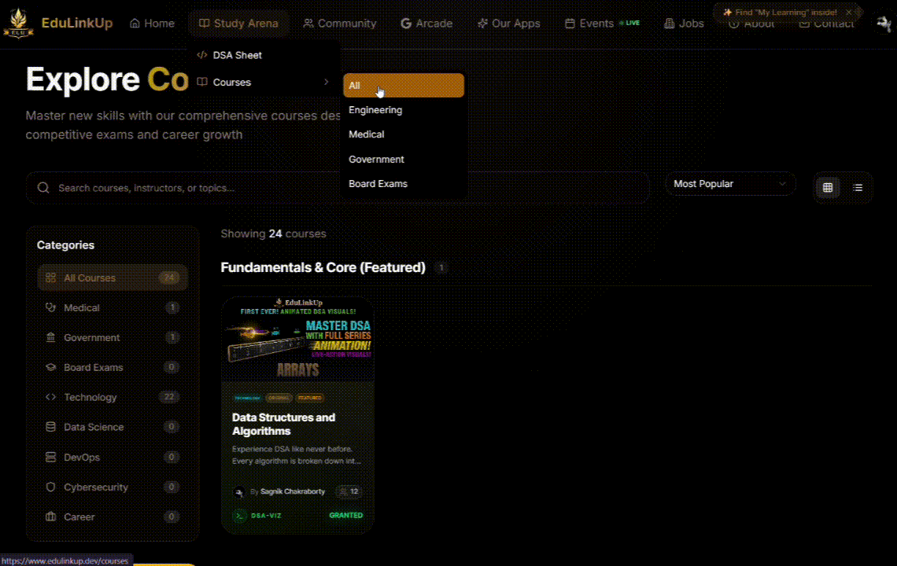
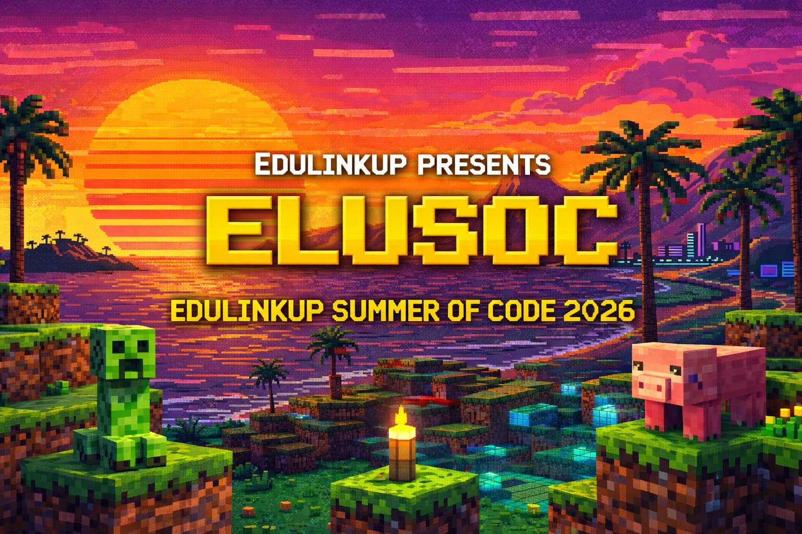

# 🎓✨ Welcome to **EduLinkUp** ✨🎓

### *Where Learning Meets Building. Where Students Become Creators.*

---

# 🔨 ELUBuild - Winter 2026 is Live!
### *Build. Ship. Belong. Stop building abandoned todo apps.*

 

<!-- Badges Strip -->

---

Hey all @edulinkup-interns/opensource, After months of silent planning, registrations for our flagship solo product incubator **ELUBuild (Winter 2026)** in partnership with **Unstop** are officially open!

No weekend speed-runs. No code thrown away on Monday. A 60-day structured arena to build a real full-stack product and ship it to real users.

### ⚡ Highlights at a Glance
* **Solo Builders Only**: 100% individual accountability.
* **Modern Stack**: Built with **Next.js** & **Supabase** inside `edulinkup-interns`.
* **Real Distribution**: Winning products launch on the **ELU Store** with sponsored **Google Play Store publication**!
* **Rewards & Swags**: Physical Certificates, exclusive **ELUBuild × Unstop Swag Kits** (t-shirts, notebooks, stickers), `.xyz` domain vouchers, and verified credentials.

> [!IMPORTANT]
> **Registration Deadline**: **25 December 2026 (11:59 PM IST)**  
> *Limited slots available for idea shortlisting. Free to enter.*

---

### Ready to build something real?

  

---

<!-- 🔥 ELUCODE NEWSFLASH -->

&nbsp;&nbsp;

⚡ Competitive Programming Series · Free to Enter · Limited Spots · Sharpen your edge.

---

## The EduLinkUp Ecosystem

**A fully live, student-first platform ~ everything you need to go from learner to builder.**

### 📚 Free, Structured, Certified Courses

A curated library of **structured learning tracks** ~ from beginner to advanced ~ complete with **progress badges**, **certificates**, and **premium content unlocks**.

> Wide-ranging domains: Web Dev · AI/ML · Data · Cloud · Backend · Full Stack · Cyber Security · and more.

---

### 💻 Data Structures and Algorithms (ELU DSA Mastery Sheet)

Master **Data Structures & Algorithms** with our dedicated DSA track ~ structured lessons, interactive problems, and a growing library of video tutorials.

&nbsp;&nbsp;

---

### 🛠️ Certified Internships Free of Cost

**Free, structured, skill-based internships** across 10+ domains ~ no gatekeeping, no fees. Build real projects, get certified, and show the world what you're made of.

🏆 **Domains:** Web · Backend · Full Stack · AI/ML · Data · Cloud · IoT · Cyber Security · Blockchain · Python

&nbsp;&nbsp;

&nbsp;&nbsp;

---

### 🏕️ ELUSOC 2026 ~ Chapter Closed

EduLinkUp's open-source contribution program wrapped up with incredible energy. Contributors built, collaborated, and shipped ~ and the winners have been officially crowned!

&nbsp;&nbsp;&nbsp;&nbsp;

💜 Thank you to every contributor who made ELUSOC what it was. Stay tuned for ELUSOC 2027!

---

### ☁️ Google Arcade Calculator ~ *Track Your Progress*

**Calculate your Arcade milestone progress**, track your badges (Skill, Trivia & Games), and know exactly where you stand for swag eligibility.

&nbsp;&nbsp;&nbsp;&nbsp;

---

## 🌐 Find Us Everywhere

   

---

### 💬 Join the Developer Community

**Stay in the loop on everything EduLinkUp:**

---

### 📩 Connect with Me

---

## 💜 You're Part of Something Real

**You're not just a member. You're a co-creator of this story.**

<table>
<tr>
<td align="center">🎓 <b>Curious?</b> Explore courses</td>
<td align="center">💡 <b>Motivated?</b> Apply for internships</td>
<td align="center">⚡ <b>Competitive?</b> Join ELUCode</td>
<td align="center">🌟 <b>Ready?</b> Let's grow together</td>
</tr>
</table>

---

### ✨ Learn. Build. Grow. Together. ✨

